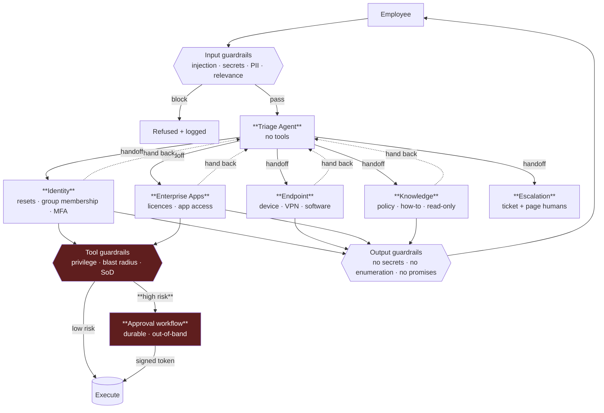

# OpenAI Agent Architecture Review
### Enterprise internal support platform — Veridian Group, 28,000 employees

**Scope:** IT helpdesk automation. ~4,200 tickets/week: access requests,
device problems, enterprise application issues, policy questions.
**Stack:** OpenAI Agents SDK, Responses API, Python.

---

## 1 · Architecture and agent roles

| Agent | Owns | Tools | Never |
|---|---|---|---|
| **Triage** | intent classification, routing | **none** | answers a question |
| **Identity** | passwords, groups, MFA | `lookup_user`, `reset_password`, `add_to_group`, `request_mfa_reset` | privileged groups without approval |
| **Endpoint** | devices, VPN, software | `get_device`, `push_software`, `reset_vpn_cert` | touches identity |
| **Enterprise Apps** | app access, licences | `check_licence`, `grant_app_access`, `request_licence` | grants admin roles |
| **Knowledge** | policy, how-to | `search_kb` (read-only) | any write |
| **Escalation** | tickets, paging | `create_incident`, `page_oncall` | resolves anything itself |

**The Triage agent is constructed with no tools at all.** It cannot answer even
if the model tries, so it cannot half-solve a request and hand over a mess.
Full definitions: [supporting/agent-roles-and-tools.md](supporting/agent-roles-and-tools.md).

---

## 2 · Handoff strategy

Handoffs, not delegation: **control transfers**. The receiving agent owns the
conversation with its own instructions and tools; Triage steps out of the way.
Specialists can hand back, so a ticket that changes subject is re-routed rather
than answered badly by whoever picked it up — the graph has a cycle, on purpose.

Routing is a **model decision constrained by structure**, not a classifier:

| Mechanism | Effect |
|---|---|
| `handoff_description` per agent | the only routing signal the model sees |
| Tool scope | a misroute cannot cause a wrong action — the tool is simply absent |
| Max handoff depth 4 | bounds ping-pong between two specialists |
| Routing-mix alarm | catches silent misrouting; **no RED metric moves when it drifts** |

**Tool scope is what makes misrouting survivable.** If Endpoint receives an
access request, the worst case is a handoff back — it has no identity tools to
misuse. Routing accuracy is a quality metric, not a security control.

---

## 3 · Guardrails

Three layers, each catching what the others cannot.

| Layer | Runs | Catches | Bypassable by prompt? |
|---|---|---|---|
| **Input** | before the agent | injection, pasted secrets, off-topic, oversized | No — runs first |
| **Output** | on the final reply | credential echo, **account enumeration**, unqualified commitments | No — runs last |
| **Tool** | inside each tool | privilege level, blast radius, segregation of duties | **No — it is code on the execution path** |

Deterministic patterns run before any model-based check: free, no
hallucination, and a guardrail costing as much as the request it guards gets
switched off within a quarter.

**The tool layer is the one that matters.** Input and output guardrails reduce
the *probability* of a bad action; the tool layer bounds the *consequence*. A
request to add someone to `Domain Admins` is refused by a Python `if`, and no
amount of persuasion changes a Python `if`.

Output guardrails also block **enumeration**: "no account exists for that
address" tells an attacker which addresses do. Responses are templated so the
phrasing cannot drift.

Catalogue: [supporting/guardrails-and-approvals.md](supporting/guardrails-and-approvals.md).

---

## 4 · Stateful workflow

Two kinds of state, deliberately separated.

| | Conversation | Approval workflow |
|---|---|---|
| Mechanism | SDK `Session` (Postgres-backed) | durable record + Responses API `previous_response_id` |
| Keyed on | `conversation_id` | `ticket_id` |
| Lifetime | 30 days | until approved, rejected or expired |
| Survives | process restart | **session expiry, redeploys, days of elapsed time** |

**A pending approval must not live in conversation state.** An approver may act
tomorrow, or next week. If the pending change sat in session state, a session
expiry or a redeploy would silently lose it — and the employee would be waiting
on something that no longer exists.

So the approval is a row in a database, and the agent resumes from it. The
Responses API threads the post-approval review server-side via
`previous_response_id`, which is the right tool for a single-shot continuation
with no tools and no handoffs.

---

## 5 · Human-in-the-loop

| Action | Approver | Why |
|---|---|---|
| Privileged group membership | Security + line manager | standing privilege |
| MFA reset | Service desk L2 (separate human) | classic account-takeover vector |
| Mailbox delegation | Data owner | reads someone else's mail |
| Licence spend > €500 | Cost-centre owner | financial commitment |
| Bulk change > 10 users | Platform lead | blast radius |
| Anything touching an exec account | Security | targeted-attack surface |

### The control that makes this real

**Approval is verified by the tool at the moment of execution, against a signed
record created out of band. It is never asserted in the conversation.**

If the agent could "remember" that a human approved, a crafted message could
claim an approval occurred and the model might act on it. Instead:

1. Agent calls `request_approval()` → durable record, Slack/ServiceNow card
2. A human approves **in that system**, authenticated separately
3. Agent calls `add_to_group(approval_token=…)`
4. **The tool verifies the token server-side** — signature, scope, expiry,
   and that the approver is not the requester

Step 4 is the control. The transcript is an untrusted input; the signed record
is the fact. Approver ≠ requester is enforced here too, so the agent cannot be
talked into approving on someone's behalf.

---

## 6 · Tracing and observability

SDK traces grouped by `ticket_id`, plus OpenTelemetry spans for model calls,
tool calls, guardrail decisions and handoffs. Both sinks: the OpenAI dashboard
for investigation, structured JSONL/OTLP for alerting and retention.

Guardrail spans record **allow as well as block** — recording only blocks gives
a denominator of zero, and the block *rate* is the signal.

| Alarm | Class | Why |
|---|---|---|
| Error rate, p95 latency, cost/ticket | RED | the easy case |
| **Guardrail false-positive rate** | Behavioural | blocked tickets make latency and cost *improve* |
| **Routing-mix drift vs baseline** | Behavioural | silent misrouting; no RED metric moves |
| **Approval-token verification failure** | **Security** | should be impossible — alarmed because it is |
| Tool refusal-rate change | Behavioural | a policy change nobody announced |

Details: [supporting/observability-plan.md](supporting/observability-plan.md).

---

## 7 · Risk analysis

| Risk | Impact | Mitigation | Residual |
|---|---|---|---|
| **Injection → privilege escalation** | Critical | tool-layer privilege check; approval required; token verified server-side | Low |
| **Approval spoofed in transcript** | Critical | signed out-of-band record; tool verifies, never the model | Low |
| Account enumeration | Medium | templated non-committal responses; output guardrail | Low |
| Over-broad tool scope after a refactor | High | scope asserted in CI; widening needs security review | Low |
| Knowledge agent leaks restricted policy | Medium | KB index filtered by requester's entitlements | Medium |
| Silent routing regression | Medium | routing-mix alarm; eval suite gates deploys | Low |
| Model version drift | Medium | pinned version; eval suite before upgrade | Low |
| Cost runaway | Low | per-ticket budget; tiered models; cost alarm | Low |

**Prompt injection is not solved, and claiming otherwise would be dishonest.**
Guardrails lower the probability that a crafted ticket reaches a tool with bad
instructions. What bounds the outcome is that privileged actions require a
signed approval the model cannot forge — so the worst case is a *request* a
human declines, not an escalation.

**Probability controls and consequence controls are different things, and only
the second survives an attacker cleverer than your patterns.**

Full checklist: [supporting/risk-checklist.md](supporting/risk-checklist.md).
